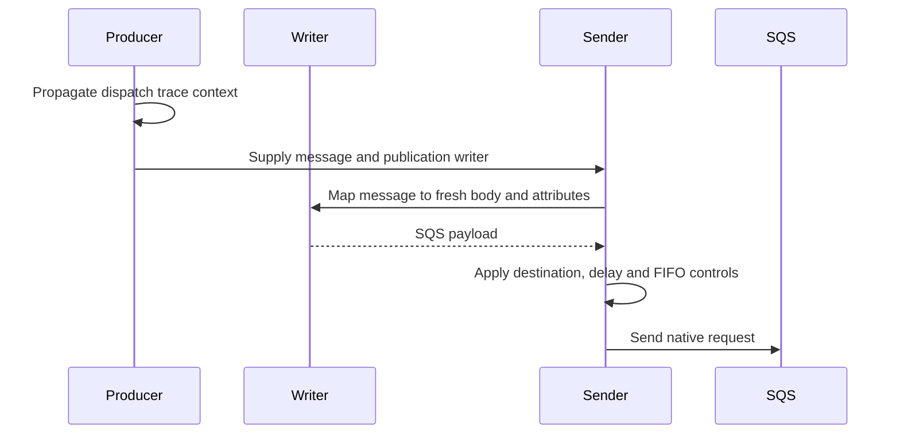
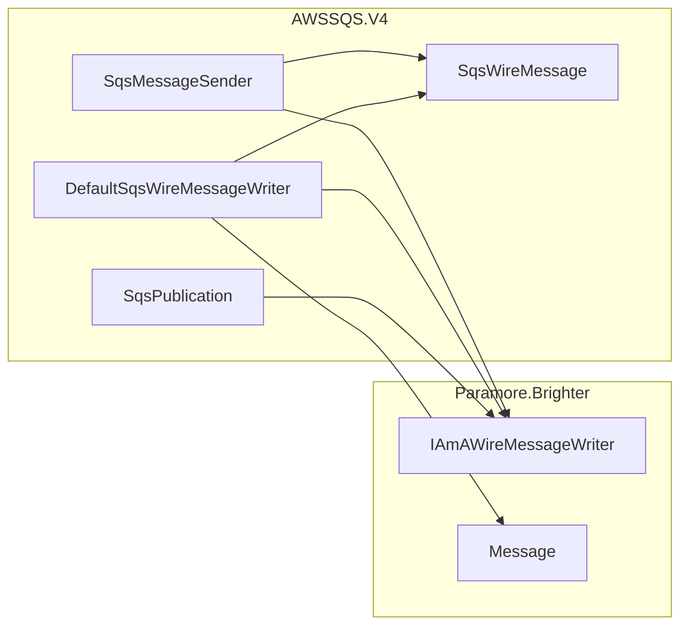

# 0086. Configure wire message writers per endpoint

## Status

Proposed for upstream acceptance. This decision applies to all gateway packages in
issue #4170. Endpoint reader/writer integration is present across the local tree;
remaining dispatch combinations, native-environment findings and final release
validation are tracked in the
[completion plan](../../specs/0038-wire-message-mapping/completion-plan.md).
The [configuration review](../../specs/0038-wire-message-mapping/configuration-design-review.md)
chooses typed default composition as the issue's permitted alternative to a DSL.
Implementation evidence does not establish upstream acceptance or release readiness.

## Context

Applications can map their request types into Brighter messages, but gateways normally decide where message metadata appears on the wire. Legacy integrations can require a bag value or trace context in a different native attribute. The application mapping pipeline runs before outbox dispatch, so it cannot control the final transport encoding or incorporate trace context added at send time.

### Scope

Parent requirement: [User defined wire message mapping](../../specs/0038-wire-message-mapping/requirements.md).

In scope:

- Requirements 1 and 3: publication-selected writers and reusable default serialization.
- Requirement 6: subscription-selected mapping for consumer-owned RabbitMQ retry publication.
- Requirement 2: an absent writer preserves the existing format and public constructor signatures.
- Requirements 4 and 5: mapping body and application metadata after existing producer trace propagation.
- Requirements 6 and 7: gateway-owned delivery controls and fresh native output without source mutation.
- Requirement 10: a shared contract without broker SDK dependencies, used by every gateway integration.

Out of scope:

- Inbound mapping is specified by ADR 0087. Provider-specific native controls and validation evidence remain in the parent specification.
- Application request mapping, transform pipelines, and inbox/outbox persistence formats retain their existing contracts.
- A mapping DSL is a possible convenience layer over the contracts; it is not needed for class-based mapping.

### Applications need to choose native metadata locations

| Configuration | Native representation |
| --- | --- |
| No writer configured | Current body, Brighter attributes and CloudEvents metadata |
| Complete custom writer | Body and application attributes selected entirely by the application |
| Custom writer composing the default | Default representation with selected fields changed |

A transport payload can be replaced without replacing its producer, scheduler or acknowledgement machinery. For SQS, the sender currently combines payload construction with delivery settings; extracting payload construction exposes that choice without exposing queue control.

### The forces

- Native types differ by transport, and broker SDK references belong in gateway assemblies.
- Existing constructors and omitted configuration must remain compatible.
- Trace context is available at dispatch time and must be visible to the writer.
- Shared mapping instances must not retain per-message state or mutate messages reused by retries.
- Public extension points must be exercised through the same publication/subscription configuration and producer/consumer factories used by applications.

## Decision

**Select typed wire writers per endpoint, with reusable default implementations and gateway-owned delivery operations.**

The core contract describes conversion into a gateway's native payload type. Applications can replace the mapping or compose the default implementation. The SQS payload contains the body and message attributes; the sender supplies the queue URL, delay and FIFO controls separately.

### The mechanism, end to end

An absent custom writer selects the default implementation. A mapping exception prevents the subsequent native send. The default writer copies the filtered bag before adding the wire handled count, so serialization does not alter the source message.

### Where the pieces live

### Key Components

#### The roles, and what each is responsible for

| Role | Type | Responsibilities | Responsibility classifier | Collaborators |
| --- | --- | --- | --- | --- |
| Convert application payload | `IAmAWireMessageWriter<TWireMessage>` | Express conversion into a typed native payload | doing | `Message`, gateway payload |
| Select mapping | `SqsPublication` | Carry an optional configured writer | knowing | Producer and writer |
| Preserve default serialization | `DefaultSqsWireMessageWriter` | Create existing body and attributes without source mutation | doing | Message and SQS payload |
| Carry SQS content | `SqsWireMessage` | Hold body and native attributes | knowing | Writer and sender |
| Deliver to SQS | `SqsMessageSender` | Combine payload with delivery controls and invoke the SDK | doing | Writer and SQS client |

| Member | Input | Output | Error conditions |
| --- | --- | --- | --- |
| `IAmAWireMessageWriter<T>.WriteMessage` | Brighter message with available dispatch trace context | Fresh payload | Mapping exceptions propagate to the caller |
| `SqsPublication.WireMessageWriter` | Writer instance or null | Mapping selection | Caller supplies a thread-safe implementation |
| `DefaultSqsWireMessageWriter` constructor | Queue URL for the default topic attribute | Reusable stateless writer | The sender separately owns destination validation |
| `DefaultSqsWireMessageWriter.WriteMessage` | Brighter message | Body and default attributes | Existing serialization errors propagate |
| `SqsWireMessage.Body`, `MessageAttributes` | Native content | Payload for the sender | Native content remains subject to SQS validation |
| `SqsMessageSender` three-argument constructor | Queue URL, client, optional writer | Configured sender | Existing connection and send failures retain their behavior |

#### Where each type is touched

| Assembly | Type | Change |
| --- | --- | --- |
| Core | Writer contract | New covariant generic interface without SDK dependencies |
| AWS V4 gateway | Publication | Optional typed writer property |
| AWS V4 gateway | Producer | Pass publication writer after trace propagation |
| AWS V4 gateway | Sender | Delegate mapping; preserve two-argument constructor |
| AWS V4 gateway | Default writer and payload | New reusable mapping and native content type |

Existing application mappers, consumers, outbox schemas, producer factories and delivery settings retain their existing responsibilities. The factory already passes the publication to the producer.

### Gateway-wide configuration

| Gateway | Publication writer | Subscription reader | Wire types |
| --- | --- | --- | --- |
| SQS, AWS SDK v3/v4 | `SqsPublication.WireMessageWriter` | `SqsSubscription.WireMessageReader` | `SqsWireMessage` / SDK SQS `Message` |
| SNS, AWS SDK v3/v4 | `SnsPublication.WireMessageWriter` | Receiving SQS subscription | `SnsWireMessage` / SDK SQS `Message` |
| RabbitMQ Async/Sync | `RmqPublication.WireMessageWriter` | `RmqSubscription.WireMessageReader` | Gateway-specific `RmqWireMessage` / `BasicDeliverEventArgs` |
| Kafka | `KafkaPublication.WireMessageWriter` | `KafkaSubscription.WireMessageReader` | Confluent `Message<string, byte[]>` / `ConsumeResult<string, byte[]>` |
| Azure Service Bus | `AzureServiceBusPublication.WireMessageWriter` | `AzureServiceBusSubscription.WireMessageReader` | `ServiceBusMessage` / `ServiceBusReceivedMessage` |
| GCP Pub/Sub | `GcpPublication.WireMessageWriter` | `GcpPubSubSubscription.PullWireMessageReader` or `StreamWireMessageReader` | `PubsubMessage` / `ReceivedMessage` or `GcpStreamMessage` |
| MQTT | `MqttPublication.WireMessageWriter` | `MqttSubscription.WireMessageReader` | `MqttApplicationMessage` |
| Redis | `RedisMessagePublication.WireMessageWriter` | `RedisSubscription.WireMessageReader` | `string` |
| RocketMQ | `RocketMqPublication.WireMessageWriter` | `RocketSubscription.WireMessageReader` | `RocketMqWireMessage` / `MessageView` |
| SQL Server | `MsSqlPublication.WireMessageWriter` | `MsSqlSubscription.WireMessageReader` | `string` |
| PostgreSQL | `PostgresPublication.WireMessageWriter` | `PostgresSubscription.WireMessageReader` | `string` |

The native type belongs to its gateway package and SDK version. Default adapters
are public composition targets. An unset writer preserves the prior encoding;
a configured writer is invoked on actual publication after trace propagation.
SQL writers must produce valid content for the existing queue column; they do not
change database schemas or outbox serialization.

Consumer-created retries and forwarding require an explicit outbound selection.
A reader is never treated as its own inverse. Immediate requeue writers and
invalid/dead-letter writers are captured with the consumer where supported.
Scheduler-backed retries carry a publication lookup key in a private message copy;
registered publications provide the writer when the callback executes. Delegates
are not persisted into scheduler jobs. Native retry/visibility operations that do
not republish content do not acquire a new mapping step.

Successful callback handling does not imply successful business publication.
When the existing mediator retains a failed send in the outbox, recovery must
follow the configured outbox policy. Existing forwarding settlement semantics
remain transport-specific: SQL Server read-and-delete, PostgreSQL rejection cleanup
and RocketMQ source acknowledgement do not become atomic with destination writes.

The concrete consumer selections remain separate from publication mapping. Kafka
and MQTT expose immediate retry, invalid-message and dead-letter writers; their
scheduled retries use `ScheduledRequeuePublicationTopic` for registered producer
lookup. MQTT rejection failures retain logged/true-result semantics, while Kafka
requires persistence confirmation before advancing source offsets. These policies
are not changed by configuring a converter.

GCP pull and streaming rejection use subscription-selected invalid/dead-letter
writers. Their cached producers remain separate when both routes name one topic;
invalid-message fallback selects the dead-letter writer. Mapping failure retains
the existing release/nack policy rather than acknowledging successful forwarding.

ASB native queue/forwarding retry captures the consumer factory publication's
`WireMessageWriter`. The global Azure scheduler factory captures its explicit
`RequeueWireMessageWriter`; directly created queue retry schedulers expose an
init-only `WireMessageWriter`. Mapping follows retry trace propagation, while the
scheduler owns retry/original identity, session, partition and handled count.
Null retains the legacy raw-body retry format. Mapping failures leave the source
uncompleted and permit recovery. Local SDK-I/O regressions pass; hosted queue/session
scheduling acceptance remains a release requirement.

### Technology Choices

#### Why generic contracts and native payloads

The shared contract supplies a consistent role while each gateway keeps its SDK types. A universal dictionary would discard native type information and require conversions that differ between brokers. SQS uses a small carrier because its SDK send request also includes delivery operations.

#### Why composition for default reuse

Composition lets applications alter the fresh result without inheriting serialization internals. The default SQS writer is sealed; private helpers remain implementation details. The public mapper is useful to applications, not an export added solely for testing.

#### Why synchronous conversion

The conversion operates on in-memory messages. Producers continue to own synchronous and asynchronous I/O. Adding an asynchronous mapper contract would imply an additional I/O lifecycle without a current requirement.

### Implementation Approach

1. Introduce the core writer contract, SQS payload, publication property and sender overload through a native-output integration test.
2. Extract the existing serialization into the default writer without changing the wire fields.
3. Use the approved composition test to expose source-bag mutation, then stamp the handled count in a filtered copy.
4. Run both sync and async integration cases, supported-target builds and full AWS V4 regressions. Inspect native messages independently rather than relying only on matching custom readers.

### Second transport: RabbitMQ Async

`RmqPublication.WireMessageWriter` uses the same generic writer contract with an `RmqWireMessage` carrier. That carrier holds `BasicProperties` and `ReadOnlyMemory<byte>` because the SDK publishes properties and bytes as separate arguments. The public factory reaches both synchronous and asynchronous sends in the Async gateway.

The publisher selects the configured application mapping, then applies the gateway's persistent-delivery setting and delivery headers. The producer's existing pending-confirmation record remains keyed by its original Brighter ID and topic, so a custom wire message ID does not change outbox confirmation identity. The SDK's publish-sequence header remains transport bookkeeping.

The approved test replaces properties, headers and body, then observes native broker data independently and checks the original confirmation identity. Named mutations establish that ignoring the writer and losing persistence enforcement fail the test.

`DefaultRmqWireMessageWriter` exposes the existing mapping for composition. It creates fresh properties and header dictionaries while retaining the body's read-only memory representation. Default publishing and requeueing use that same mapping. Requeueing still replaces the native message ID and applies delivery and original-message metadata in the gateway; it does not select a publication's custom writer. The composition test renames one tenant header and verifies the remaining default fields and source message. Omitting the CloudEvents ID fails its header-presence assertion.

The publisher removes writer-supplied delay headers before applying its own delay. An immediate send therefore emits no `x-delay`, as verified through independent native inspection. Writer-supplied delivery tags are similarly removed before applying the source message's tag, when present. Native observation covers both source-tag states in sync and async modes. A separate native-delay test confirms the gateway's three-second delay takes precedence over a custom writer's 60-second header while preserving custom payload and original confirmation identity. Omitting the gateway delay assignment fails the native header-presence assertion. Remaining reserved-header collisions require further coverage.

#### RabbitMQ Sync native property creation

RabbitMQ Client 6 keeps its concrete properties class internal and creates it
through the publishing channel. The Sync wire value therefore carries a body and
an optional configuration callback accepting IBasicProperties. The gateway creates
a fresh native instance, invokes the callback once, applies delivery controls and
publishes. Default composition wraps the default callback; custom writers do not
need a separate connection, reflection or a parallel native-properties DTO.

The callback must only populate the supplied object and must not retain it. Default
mapping snapshots application values during WriteMessage. Successful endpoint
coverage is recorded in the [Sync amendment](../../specs/0038-wire-message-mapping/review/rmq-sync-native-properties/README.md).
Subsequent Sync recovery, direct/native-delay retry, invalid forwarding and scheduled
publication-selection packages validate those consumer paths separately. Their current
scope is recorded in the completion plan. This transport difference leaves the shared
Core writer contract unchanged.

#### Consumer-owned RabbitMQ retry mapping

`RmqSubscription.RequeueWireMessageWriter` selects the writer when a consumer republishes directly to RabbitMQ for retry. A consumer has no producer publication from which to select that mapping. Both consumer factories capture the setting internally; public constructor signatures remain unchanged. An unset setting preserves default serialization.

Selection is per consumer, even when consumers share a factory and connection. Four cases create default and custom subscriptions in both orders through both factory paths before requeueing. Independent native reads verify each format, retry controls and source settlement. Temporarily making the consumer's writer field static causes all four cases to fail at native body equality. These checks establish configuration isolation.

Two additional cases verify overlapping output lifetimes through a shared composing default writer. Conversion runs under the helper's lock; a barrier outside it prevents either result from returning until both exist. Native reads verify independent bodies and application metadata, source persistence, unique retry identity and source settlement. Reusing the first body's memory makes both cases fail at native body equality. This proves the outputs remain independent across overlapping retries without claiming simultaneous execution inside the default converter.

The writer controls application content. After conversion, the gateway generates the retry message ID and applies source persistence, handled count, delivery marker and delay. It supplies the original-message ID from the source, retaining an earlier original ID even when the writer omits it. The existing source header spelling and value remain intact. Serialization does not mutate the source message or bag.

Four immediate-requeue cases cover both factory paths and first/subsequent retries. Native observation verifies custom content, retry controls, original settlement and an unchanged source. Ignoring the writer fails native body equality; omitting persistence enforcement fails native delivery-mode equality.

Four native delayed-requeue cases verify the same mapping and controls through both factory paths. The requested three-second delay replaces a writer-supplied sixty-second delay. Queue-specific routing delivers the retry only to its source queue, even when another queue shares the application topic. Bypassing the writer fails native body equality; removing the delay header fails the native header-presence assertion. Scheduler-backed retry retains the scheduler's publication mapping; the subscription setting does not configure that path or invalid-message forwarding. These distinctions prevent a retry-specific mapping from silently changing rejection serialization.

Immediate retry writer failures retain the original delivery. Four cases cover throwing and invalid null-returning writers through both factory paths. Requeue reports false, native inspection confirms the original identity and payload remain, and a later consumer succeeds after writer recovery. Premature acknowledgement fails original-delivery presence; reporting success after failure fails the result assertion. These checks preserve the existing failure behavior without treating null as a supported wire representation.

Four further cases verify the same failure and recovery guarantees with native delayed retry. While an independent native reader holds the original, no extra copy appears during an observation window longer than the requested delay. Recovery through a new consumer preserves custom content and gateway retry controls, waits for the requested delay and settles the source. Both acknowledgement and false-success mutations fail at their intended assertions. These checks do not make publication and acknowledgement atomic or establish scheduler-backed recovery.

Eight cases verify conflicting canonical retry headers across both factory paths, first/subsequent retries and immediate/native delayed delivery. The gateway replaces an invented handled count and original ID, delivery marker and delay while retaining custom content. Omitting handled-count enforcement fails native count equality; omitting original-ID enforcement fails native identity equality. These cases do not establish case-variant collision behavior.

Original-ID lookup and cleanup use ordinal case-insensitive comparison because this reserved identifier must not depend on process culture. Before assigning the source identity, the publisher removes writer-supplied case variants from the native dictionary. It snapshots matching keys before removal. A first retry emits the canonical name and source ID; a subsequent retry retains the source key spelling and original value. Four native tests reproduce duplicate entries before the correction and pass afterward. Omitting cleanup restores that failure. This rule is limited to original-ID bookkeeping.

Incoming mapping is covered by ADR 0087. Scheduler-backed retry retains its existing mapping. The subscription retry writer configures neither that path nor invalid-message forwarding; invalid forwarding has its own selection.

### SNS publication mapping

`SnsPublication.WireMessageWriter` selects a writer for `SnsWireMessage`, containing the body, optional subject and SNS-native attributes. SNS and SQS use different SDK attribute types, so they have separate content carriers. Both use the shared core contract without adding an SDK dependency to core.

The producer passes the writer to the publisher after topic resolution. The publisher combines its output with the resolved destination and the source message's FIFO controls. The existing two-argument publisher constructor retains default serialization. Scheduling remains in the producer before native publication.

The replacement test publishes through the public factory in sync and async modes and observes an SNS envelope through an independent SQS subscription. It verifies custom content, exclusive application attributes and an unchanged source message. Ignoring the configured writer fails the body assertion.

`DefaultSnsWireMessageWriter` supplies ordinary publication and reusable composition. Its resolved topic ARN supplies the existing `topic` attribute, while the publisher independently owns the destination. It creates fresh attributes and stamps the wire handled count in a filtered bag copy. The composition test reproduces source-bag mutation in the original mapping and verifies its removal without changing serialized metadata. Omitting the native ID fails both composition cases. Custom FIFO controls are covered with raw and enveloped delivery. SQS/SNS in-memory scheduled dispatch, endpoint isolation and overlapping output lifetimes are validated.

AWS schedules that need application mapping use callback mode
(`UseMessageTopicAsTarget = false`). The callback targets the scheduler endpoint;
the business publication's writer runs when its producer dispatches the contained
message. Native-target mode retains its existing serializer because AWS cannot
execute an application converter. Callback-pump settlement and explicit outbox
recovery after writer failure are covered by the
[scheduler validation](../../specs/0038-wire-message-mapping/review/aws-callback-pump/README.md).
This does not establish hosted IAM behavior or automatic retry of failed business sends.

### AWS consumer-owned rejection publication

Both SDK V3 and SDK V4 subscriptions expose
`InvalidMessageWireMessageWriter` and `DeadLetterWireMessageWriter`, each typed
as `IAmAWireMessageWriter<SqsWireMessage>?`. Consumers capture these selections
through the public factory and pass each to the corresponding lazy producer's
publication. Existing public constructors and null/default selections preserve
their behavior.

The two settings are independent because invalid-message and dead-letter
destinations can require different formats. Invalid-message fallback selects
the dead-letter writer. The gateway retains route selection, native delivery
operations and rejection metadata refresh. The writer controls the outgoing
representation; the incoming reader does not imply its inverse. Broker-managed
redrive does not execute an application writer.

The 72 approved cases cover sync/async factories, all three routes,
replacement/composition, and throwing/null writer recovery using independent
native SDK observations. A failed writer retains the source for redelivery and
publishes no default fallback. SQS retains its existing `Reject` return contract:
true means the failure was handled, not that forwarding succeeded. Ten named
mutations cover selected writer presence, route-specific selection, count/topic
preservation and premature source deletion.

The subsequent [FIFO/isolation cases](../../specs/0038-wire-message-mapping/review/aws-rejection-controls/README.md)
verify native group/deduplication preservation, failure recovery and independent
consumer selections in both SDKs. They do not establish atomic publication/deletion
or concurrent execution inside application converters. The validation records
retain the emulator limits and full-suite results.

### RabbitMQ consumer-owned invalid forwarding

`RmqSubscription.InvalidMessageWireMessageWriter` selects an
`IAmAWireMessageWriter<RmqWireMessage>` for invalid-message forwarding. Both
factory modes capture it in the consumer and pass it to the existing publisher.
Null preserves default serialization. Public constructors are unchanged.

This selection is independent of retry and ordinary publication writers. Rejection
metadata and the destination topic are available before conversion. The gateway
retains native routing, persistence, delivery metadata, mandatory publication and
publisher-confirmation behavior. Mapping and publication errors restore the
application topic and leave the source unacknowledged. Source acknowledgement
follows a confirmed forward; failure at that later stage can cause a duplicate.

RabbitMQ native dead-lettering remains broker-owned and cannot invoke an
application writer. Delivery errors, and unacceptable messages without an invalid
route, use `BasicReject` and retain the original wire representation. Adding a
separate dead-letter writer would imply a different application-republish path
and is not part of this contract.

The reviewed 24-case matrix uses native publication and observation for full
replacement, composition, throwing/null writer recovery, mandatory-route recovery,
per-consumer selection and native dead-letter compatibility. Seven named mutations
cover selected mapping, acknowledgement ordering, topic restoration, mandatory
publication, factory selection, native rejection and persistence.

## Consequences

### Positive

Applications can support legacy formats while keeping Brighter's producer infrastructure. Default composition keeps small customizations small. The generic contract remains independent of AWS.

### Negative

A complete custom writer is responsible for its content and metadata. For requeue, that representation must remain compatible with the subscription's reader. SQS default composition currently needs the resolved queue URL to preserve the existing topic attribute. The shared contract does not by itself validate every native transport path.

### Risks and Mitigations

Custom mappings can exceed SQS attribute limits or omit metadata needed by receivers. Document those constraints and test wire interoperability independently. Fresh output and copying the source bag avoid accumulated serialization changes during retries. Preserve public constructor signatures and use full regression suites to detect changes to default behavior.

## Alternatives Considered

- Delegates alone offer less discoverable default reuse; applications can still implement a delegate adapter over the contract later.
- A fluent DSL could simplify renames but requires conversion, precedence and fallback semantics beyond the current class-based contract.
- Application transforms cannot own native attribute placement and run before dispatch-time trace propagation.
- Replacing a complete gateway requires reproducing delivery operations to change a few fields.

## References

- [Wire mapping requirements](../../specs/0038-wire-message-mapping/requirements.md)
- [Validation plan and results](../../specs/0038-wire-message-mapping/validation.md)
- [SQS writer usage](../../specs/0038-wire-message-mapping/usage.md)
- [Issue 4170](https://github.com/BrighterCommand/Brighter/issues/4170)
